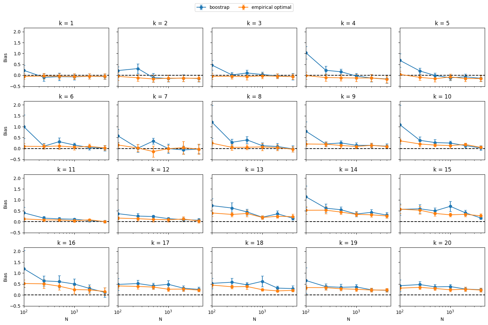
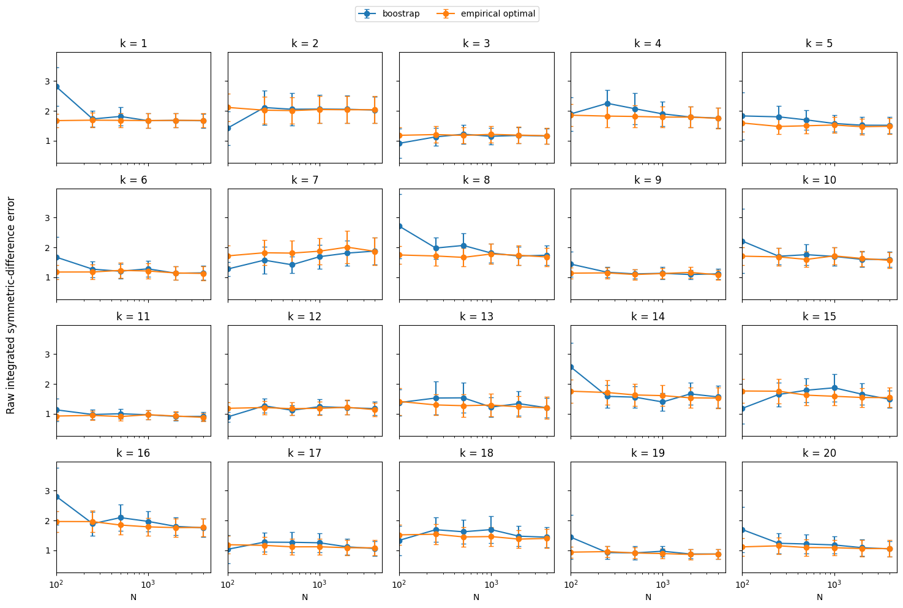
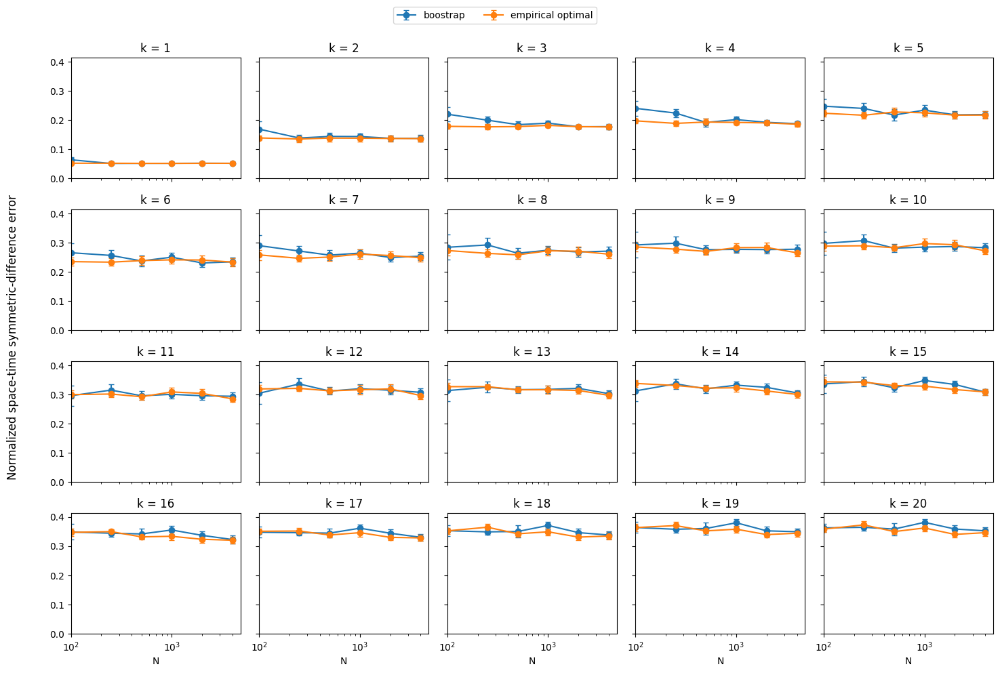

# Cell Death Simulation and Particle Filter Validation

This repository contains simulation and validation code for a stochastic spatial model of cell death. In the model, latent caspase activation creates active regions that favor further activation. A cell death can occur where an active region is present, and each observed death triggers local ERK-mediated protection. A fixed T-shaped region introduces spatial variation in the baseline activation intensity.

The particle filters use the times and locations of observed deaths to estimate the hidden state. Simulated data make it possible to compare their estimates with the hidden paths that generated the observations.

## 1. Repository structure

```text
celldeath/
├── README.md
├── gillespiealgo .py
├── rejectionalgo.py
├── validate2pf.cpp
├── plot.py
├── bias.png
├── validate2pf_raw_path_error.cpp
├── plot_raw_path_error.py
├── raw_path_error.png
├── validate2pf_normalized_path_error.cpp
├── plot_normalized_path_error.py
└── normalized_path_error.png
```

The Python simulation scripts generate sample paths. The C++ programs validate the particle filters and write their numerical results to standard output. Section 9 lists the result filenames used by the plotting scripts.

## 2. Gillespie simulation

`gillespiealgo .py` implements an event-driven Gillespie simulation of the full model. At each step, one of four events occurs.

1. A candidate activation is proposed.
2. A candidate death is proposed.
3. An active center expires.
4. An ERK protection zone expires.

## 3. Simulation by thinning

`rejectionalgo.py` provides an alternative simulation based on Poisson thinning. Candidate activations are drawn from a dominating Poisson point process with intensity $\lambda_{a,1}$ over the observation window. A candidate at location $x$ is accepted with probability

```math
p_{\mathrm{acc}}(x)
= \frac{\lambda_a(x \mid V_{t-}^a)}{\lambda_{a,1}}
= \begin{cases}
1 & \text{if } x \in A(V_{t-}^a), \\
\dfrac{\lambda_{a,T}}{\lambda_{a,1}} & \text{if } x \in T \setminus A(V_{t-}^a), \\
\dfrac{\lambda_{a,c}}{\lambda_{a,1}} & \text{otherwise.}
\end{cases}
```

Here $A(V_t^a)$ is the union of active regions and $A(V_t^p)$ is the union of ERK protection zones. The region in which a death can occur is

```math
D_t = A(V_t^a) \setminus A(V_t^p).
```

A candidate death at time $t$ is accepted if its location lies in $D_{t-}$, the region immediately before the event. To run the simulation and view the animation, use

```bash
python rejectionalgo.py
```

## 4. Particle filter validation

`validate2pf.cpp` simulates datasets from the event-driven model. The figures compare the bootstrap particle filter  with the empirical optimal proposal

Let $S_k^d$ and $Y_k^d$ be the time and location of the $k$th observed death, with $S_0^d=0$. Over the interval ending at $S_k^d$, the quantity of interest is the integrated area

```math
B_k = \int_{S_{k-1}^d}^{S_k^d} \lvert D_t\rvert \, dt.
```

The simulator records a reference value $B_k^{\mathrm{true}}$ along the hidden path. Given only the observed deaths, the filters estimate the conditional mean of $B_k$.

### 4.1. Bootstrap particle filter

The bootstrap filter propagates each particle along a hidden path and weights it by the full observation likelihood on the interval. Its potential is

```math
G_k = \lambda_d \exp(-\lambda_d B_k)
\,\mathbf{1}\!\left\{Y_k^d \in D_{S_k^d-}\right\}.
```

The indicator tests whether the observed death location lies in the region where a death is possible immediately before the event. The survival factor accounts for the absence of an observed death between $S_{k-1}^d$ and $S_k^d$. Its value is

```math
\exp(-\lambda_d B_k)
= \exp\!\left(-\lambda_d \int_{S_{k-1}^d}^{S_k^d} \lvert D_t\rvert \, dt\right).
```

### 4.2. Empirical optimal proposal

For each parent particle, the filter simulates $M_{\mathrm{prop}}$ candidate hidden path segments. Candidate $j$ has integrated area $B_j$ and observation potential

```math
G_j = \lambda_d \exp(-\lambda_d B_j)
\,\mathbf{1}\!\left\{Y_k^d \in D_{S_k^d-}^{(j)}\right\}.
```

When the sum of the potentials is positive, the filter retains one of the candidate segments $H_k^{(1)},\ldots,H_k^{(M_{\mathrm{prop}})}$ with probability

```math
\mathbb{P}\!\left(J=j \mid G_1,\ldots,G_{M_{\mathrm{prop}}}\right)
= \frac{G_j}{\sum_{\ell=1}^{M_{\mathrm{prop}}} G_\ell}.
```

Weighted reservoir sampling makes this selection as candidates are generated, so only the currently selected segment needs to be retained. The filter multiplies the parent weight by the mean candidate potential

```math
\widehat h_k = \frac{1}{M_{\mathrm{prop}}}\sum_{j=1}^{M_{\mathrm{prop}}} G_j.
```

### 4.3. Validation against simulated paths

For each of $R$ independent replicates, the simulator produces a hidden path and the death observations $O_{1:k}^d$ up to time $S_k^d$. For replicate $r$, let $B_k^{\mathrm{true},(r)}$ be the reference value calculated from that path. Let $\widehat m_{k,N}^{(r)}$ be the estimate obtained from the death observations using $N$ particles.

Averaging over replicates gives the mean reference value and the mean particle estimate, respectively.

```math
\overline B_{k,R}^{\mathrm{true}}
= \frac{1}{R}\sum_{r=1}^R B_k^{\mathrm{true},(r)},
\qquad
\overline m_{k,N,R}^{\mathrm{PF}}
= \frac{1}{R}\sum_{r=1}^R \widehat m_{k,N}^{(r)}.
```

#### Why the averages should agree

The law of large numbers gives

```math
\overline B_{k,R}^{\mathrm{true}} \longrightarrow \mathbb E_\theta[B_k]
\qquad (R\to\infty).
```

The filter approximates the conditional mean,

```math
\widehat m_{k,N} \approx \mathbb E_\theta[B_k\mid O_{1:k}^d],
```

and the law of total expectation gives

```math
\mathbb E_\theta\!\left[\mathbb E_\theta[B_k \mid O_{1:k}^d]\right]
= \mathbb E_\theta[B_k].
```

As the numbers of particles and independent replicates increase, a consistent filter should therefore satisfy

```math
\overline m_{k,N,R}^{\mathrm{PF}} - \overline B_{k,R}^{\mathrm{true}} \longrightarrow 0.
```

In any single replicate, several hidden paths can be compatible with the same observed deaths. Even an exact conditional mean can therefore differ from the value on the particular path that generated those deaths.

#### Empirical bias

Each estimate is paired with the reference value from the same simulated dataset. When all $R$ filter runs succeed, the empirical bias is

```math
\widehat{\mathrm{Bias}}_{k,N}
= \frac{1}{R}\sum_{r=1}^R
\left(\widehat m_{k,N}^{(r)}-B_k^{\mathrm{true},(r)}\right).
```

The program makes this comparison separately for each filter and each interval $k=1,\ldots,20$. Computing the Monte Carlo standard error from the paired differences accounts for variation shared by the estimate and its reference. Section 8 explains how the program treats runs in which the particle system collapses.

## 5. Approximating the spatial integral

Computing $\lvert D_t\rvert$ exactly can be expensive when several active disks and ERK protection zones overlap. The program places one sampling point in each cell of a $g\times g$ grid over the observation window $W$, where $g$ is `GRID_SIDE`. If $m=g^2$ and $n_D(t)$ is the number of points in $D_t$, then

```math
\lvert D_t\rvert \approx n_D(t)\,\frac{\lvert W\rvert}{m}.
```

The program integrates this approximate area over time to compute $B_k$ for both the simulated reference path and the particles.

## 6. Particle estimate

For interval $k$, particle $i$ yields an integrated area $B_k^{(i)}$. With normalized weights $w_k^{(i)}$, the filter estimates the conditional mean by

```math
\widehat B_{k,N} = \sum_{i=1}^N w_k^{(i)} B_k^{(i)}.
```

This is the estimate denoted by $\widehat m_{k,N}^{(r)}$ for replicate $r$ in Section 4.3.

## 7. Monte Carlo experiment

The experiment uses $N\in\{100,250,500,1000,2000,4000\}$ particles. For each $N$, the filters are evaluated on the same $R$ independently simulated datasets.

| Parameter | Default | Meaning |
| --- | ---: | --- |
| `R` | 500 | Number of Monte Carlo replicates |
| `K` | 20 | Number of observed deaths per dataset |
| `GRID_SIDE` | 40 | Number of grid cells along each side of the observation window |
| `M_PROP` | 20 | Number of candidate segments per parent particle for the empirical optimal proposal |
| ESS threshold | 0.75 | Resample when the effective sample size falls to $0.75N$ or below |

## 8. Output format

The program first prints the run configuration. With the default settings, the first line is

```text
R=500  K=20  area_points=1600  ESS_threshold=0.75  M_prop=20
```

The next line gives the column names.

```text
N k algorithm success collapse mean_true_paired mean_PF bias abs_bias paired_MCSE
```

| Column | Meaning |
| --- | --- |
| `N` | Number of particles |
| `k` | Interval index |
| `algorithm` | Particle filter used |
| `success` | Number of filter runs that completed all intervals |
| `collapse` | Number of filter runs in which the particle system collapsed |
| `mean_true_paired` | Mean reference value over successful runs |
| `mean_PF` | Mean particle estimate over the same runs |
| `bias` | Mean paired difference between the estimate and its reference |
| `abs_bias` | Absolute value of `bias` |
| `paired_MCSE` | Monte Carlo standard error of the mean paired difference |

For replicate $r$, the paired error is $E_{k,N}^{(r)}=\widehat m_{k,N}^{(r)}-B_k^{\mathrm{true},(r)}$. Write $\mathcal S$ for the set of successful runs and $R_{\mathrm{succ}}=\lvert\mathcal S\rvert$. When at least one run succeeds, the reported bias is

```math
\widehat{\mathrm{Bias}}_{k,N}
= \frac{1}{R_{\mathrm{succ}}}\sum_{r\in\mathcal S} E_{k,N}^{(r)}.
```

Read `bias` alongside `success` and `collapse`. A small bias based on a few surviving runs describes only that subset. The `paired_MCSE` column supplies the error bars for the bias figure.

## 9. Plotting the results

Save each validation program's standard output under the corresponding results filename before running its plotting script.

| C++ program | Results file | Plotting script | Quantity plotted (±1 Monte Carlo standard error) |
| --- | --- | --- | --- |
| `validate2pf.cpp` | `results.txt` | `plot.py` | `bias` ± `paired_MCSE` |
| `validate2pf_raw_path_error.cpp` | `results_raw_path_error.txt` | `plot_raw_path_error.py` | `raw_symdiff_error` ± `raw_symdiff_MCSE` |
| `validate2pf_normalized_path_error.cpp` | `results_normalized_path_error.txt` | `plot_normalized_path_error.py` | `normalized_symdiff_error` ± `normalized_symdiff_MCSE` |

At time $t$, the symmetric difference ($\triangle$) contains the locations where particle $i$ and the simulated path disagree about whether a death can occur. The raw path error integrates the area of this set over the interval. Dividing by the interval duration and the area of the observation window gives the normalized error.

```math
d_k^{(i)}
= \int_{S_{k-1}^d}^{S_k^d}
  \left\lvert D_t^{(i)}\triangle D_t^{\mathrm{true}}\right\rvert\,dt,
\qquad
d_k^{(i),\mathrm{norm}}
= \frac{d_k^{(i)}}{(S_k^d-S_{k-1}^d)\lvert W\rvert}.
```

For each interval, the programs average the errors using the particle weights, then average over successful runs. The following commands save the three figures under the filenames used below.

```bash
python3 plot.py results.txt bias.png
python3 plot_raw_path_error.py results_raw_path_error.txt raw_path_error.png
python3 plot_normalized_path_error.py results_normalized_path_error.txt normalized_path_error.png
```

## 10. Python dependencies

The Python scripts use NumPy, Matplotlib, and pandas. Install them with

```bash
pip install numpy matplotlib pandas
```

## 11. Figures

All three figures compare the bootstrap filter (blue) with the empirical optimal proposal (orange). Each panel corresponds to one interval $k=1,\ldots,20$. The horizontal axis shows the number of particles on a logarithmic scale starting at $N=100$. Error bars span one Monte Carlo standard error on either side of the mean (a 95% normal-approximation interval would use 1.96). The averages cover successful runs, so the counts in `success` and `collapse` matter when interpreting the figures.

### 11.1. Bias in the integrated area estimate



The dashed line marks zero bias. For several intervals, bias approaches zero as the number of particles increases. Positive deviations persist in some intervals.

### 11.2. Raw path error



This error measures spatial disagreement accumulated over time. Its magnitude depends on the interval duration and the size of the observation window. The two methods give similar results at large particle counts.

### 11.3. Normalized path error



The normalized error lies in $[0,1]$, so intervals of different lengths can be compared directly. Values remain around 0.30–0.35 for several later intervals. Uncertainty about the hidden path can produce positive path error even under exact filtering.
